# GameMind AI

<div align="center">

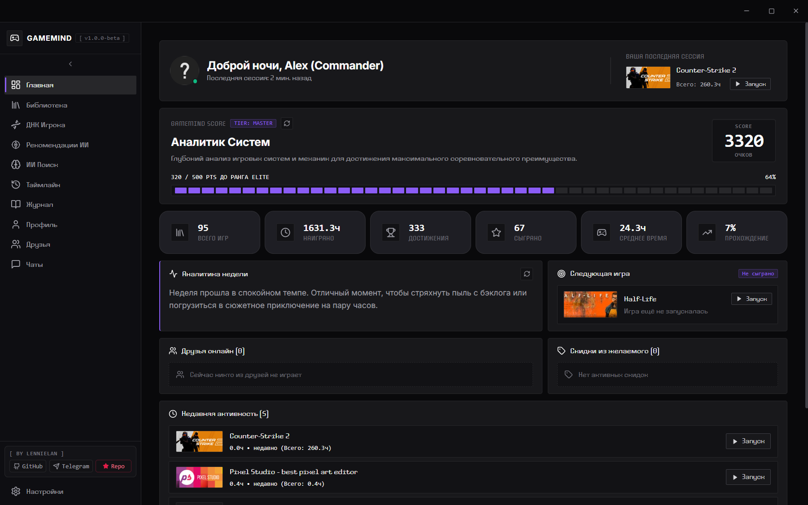

### Intelligent Desktop Gaming Companion & Steam Library Analytics Platform

[](https://github.com/lennielan/GameMind_AI/releases)
[](LICENSE)
[](https://www.electronjs.org/)
[](https://react.dev/)
[](https://www.typescriptlang.org/)
[](https://github.com/WiseLibs/better-sqlite3)
[](https://supabase.com/)

[Overview](#overview) • [Screenshots](#screenshots-gallery) • [Architecture](#architecture--tech-stack) • [Getting Started](#getting-started) • [Configuration](#configuration) • [Status & Limitations](#status--known-limitations) • [Русский раздел](#русскоязычный-раздел)

</div>

---

## Overview

**GameMind AI** is an open-source desktop companion and analytics workstation built for Steam gamers. It pairs local game telemetry and library history with multi-provider Large Language Models (LLMs) to compute personalized gamer archetypes ("Player DNA"), surface semantic game recommendations, track milestone chronicles, and provide a unified gaming cockpit.

The project is built on a **hybrid local-first architecture**:
- **Offline / Local Engine**: Steam library caching, playtime metrics, Player DNA heuristics, achievement tracking, personal timeline, and gaming journals operate 100% locally using an embedded SQLite database (WAL mode). No external accounts or cloud connectivity are required to browse your synchronized library.
- **AI & Cloud Layer**: Natural-language semantic discovery, narrative timeline synthesis, and social co-op matching connect to external LLM providers (Google Gemini, OpenAI, Claude, Groq, Ollama) via a **Bring Your Own Key (BYOK)** model, alongside optional Supabase PostgreSQL sync.

---

## Screenshots Gallery

All screenshots below are captured from live builds of GameMind AI running on realistic, sanitized gaming profiles.

### 1. Unified Dashboard

*Cockpit overview featuring the GameMind Score telemetry, Master Tier progression, playtime distribution, hardware summary, and recent session logs.*

---

### 2. Steam Library & Game Workstation
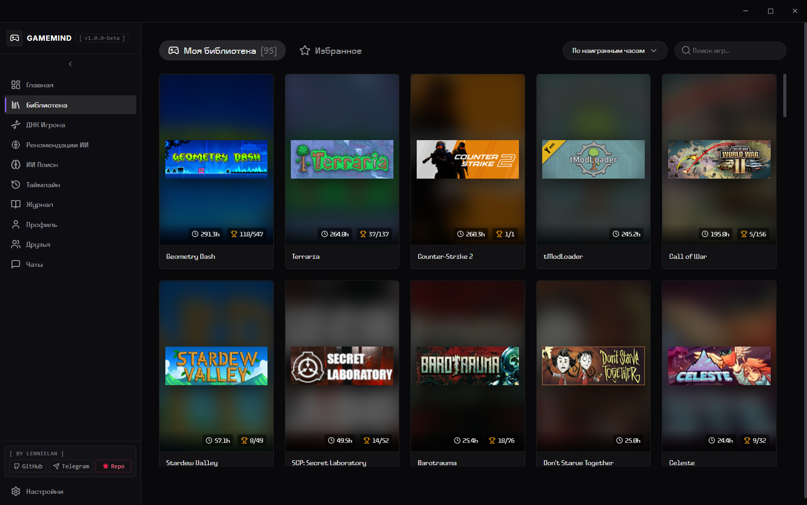
*High-density game browser with instant filtering, play status categorization, achievement completion ratios, and local metadata caching.*

---

### 3. Player DNA & Behavioral Radar
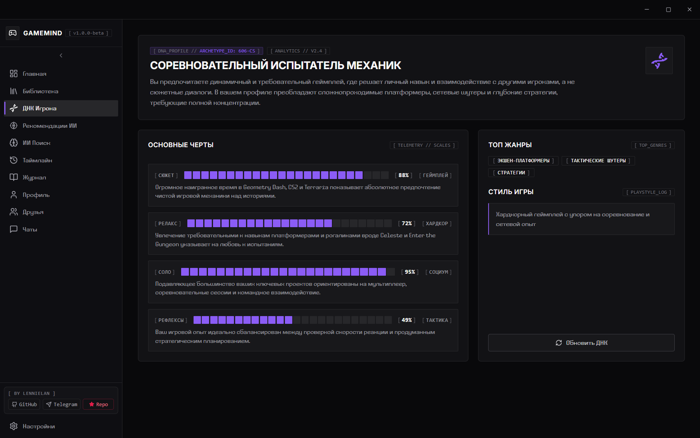
*Multi-axis gamer personality profile evaluating tactical depth, narrative appetite, mechanical intensity, resilience, and archetype classification.*

---

### 4. AI Recommendation Hub
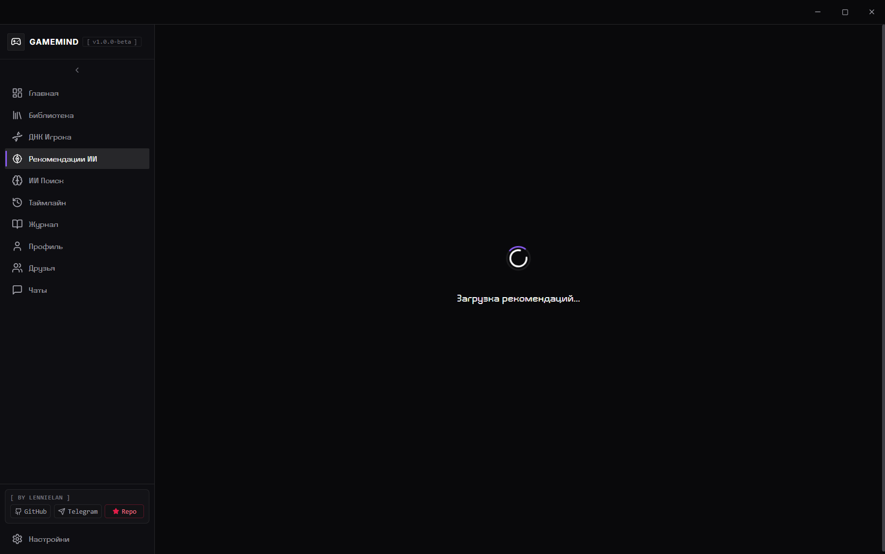
*Personalized game suggestion engine providing transparent rationales, genre affinities, and contextual match explanations.*

---

### 5. Semantic AI Search
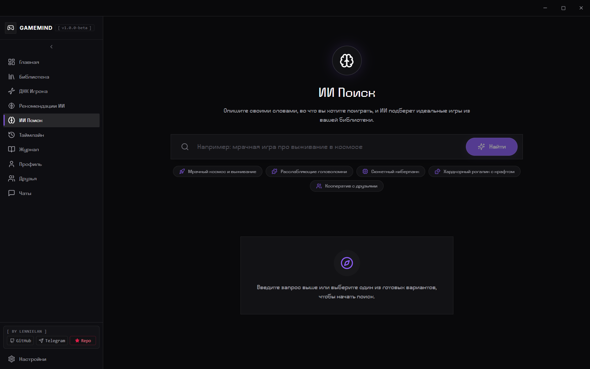
*Natural-language game query interface with instant thematic tags, vibe filters, and cross-genre associative discovery.*

---

### 6. Gaming Timeline & Chronicles
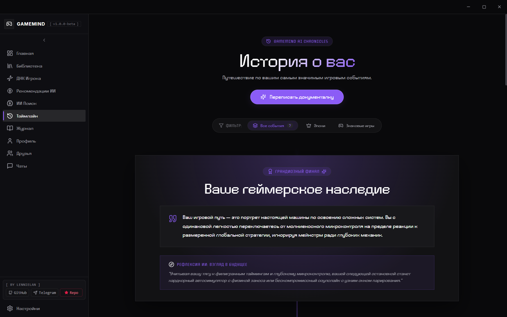
*Chronological milestones and retrospective narrative charting personal gaming eras from early discoveries to current masteries.*

---

### 7. Monthly Gaming Journal
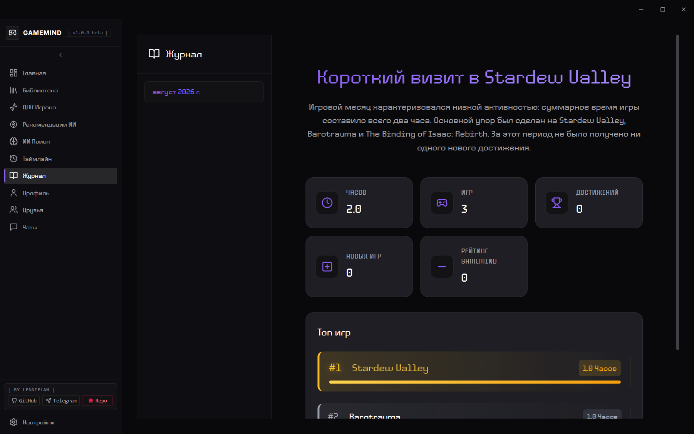
*Structured session summaries, completion notes, reflective logs, and automated monthly playtime aggregations.*

---

### 8. Gamer Profile & Showcase
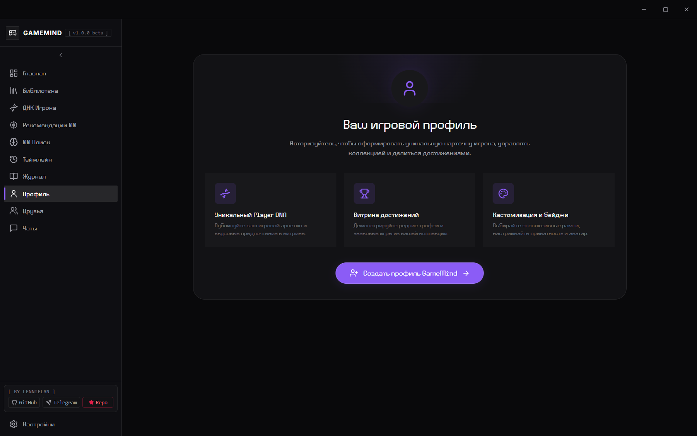
*Public-facing showcase with unlockable badges, trophy highlights, lifetime stats, and gamer identity tags.*

---

### 9. Friends & Co-op Matching
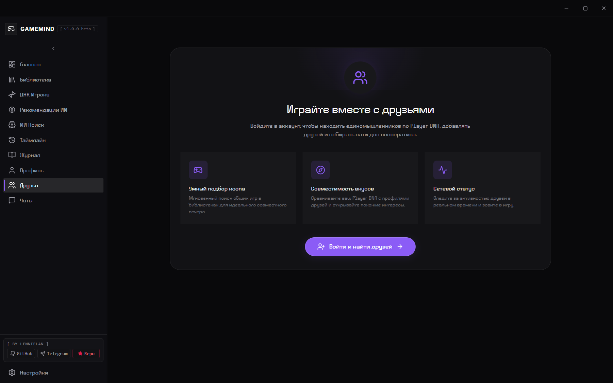
*Social compatibility hub comparing gaming libraries, overlapping genres, and playstyle synergy for multiplayer matchmaking.*

---

### 10. Settings & BYOK Provider Management
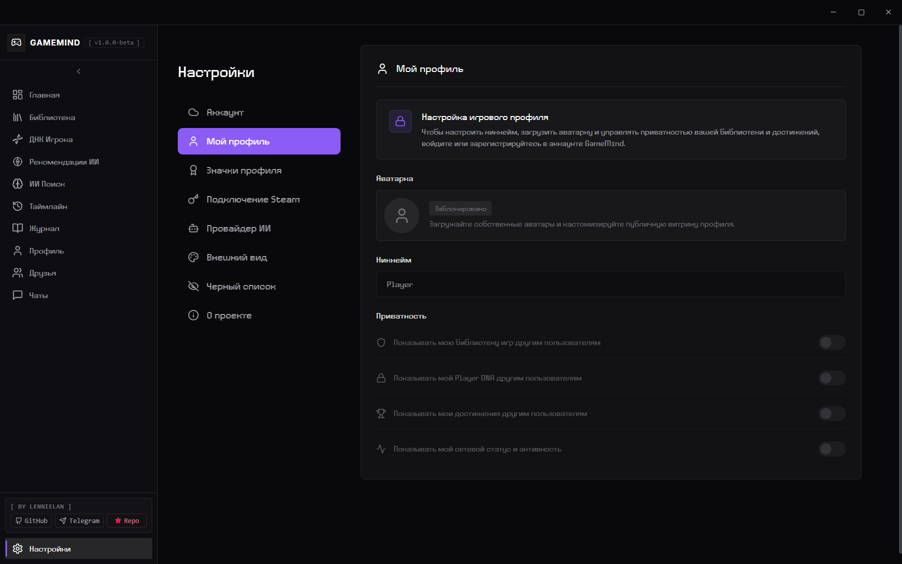
*Security-first configuration center for BYOK API keys, encrypted storage management, UI styling, and About Project disclosures.*

---

## Architecture & Tech Stack

GameMind AI follows a clean, decoupled Electron process model enforcing strict separation between operating system primitives, persistent storage, and the React user interface.

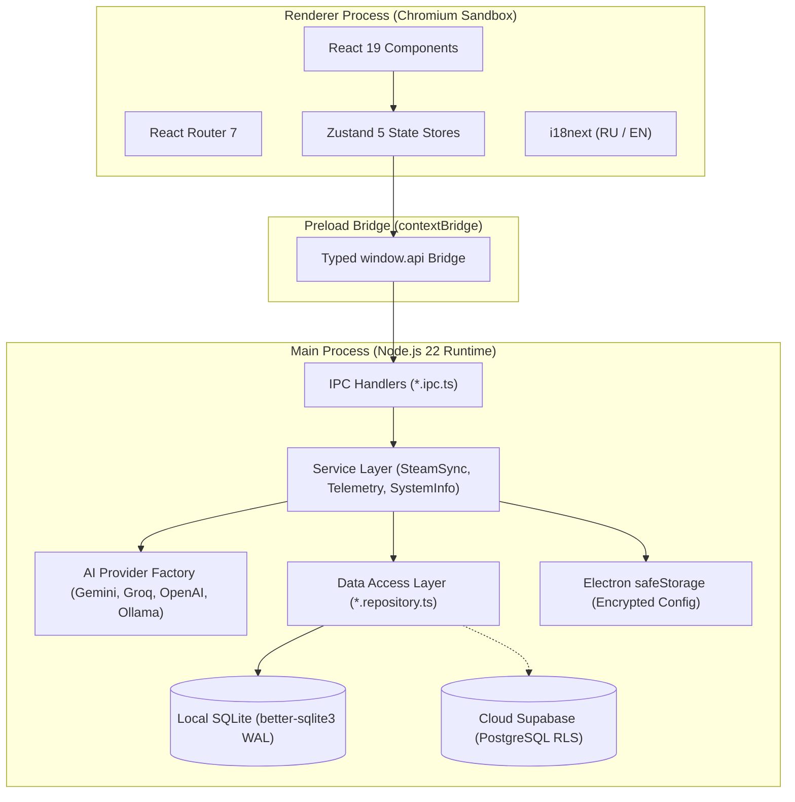

### Core Architectural Principles

- **Strict Cross-Layer Isolation**: The React renderer runs in a sandboxed environment (`contextIsolation: true`, `nodeIntegration: false`). No renderer component is permitted to execute SQL queries or call external APIs directly.
- **Unified Data Access Layer (DAL)**: All database transactions are restricted to dedicated repository modules (`*.repository.ts`) instantiated through `src/main/database/repository.factory.ts`.
- **Bring Your Own Key (BYOK)**: Zero hardcoded API keys exist in the codebase. All external credentials (Gemini, OpenAI, Claude, Groq, Steam Web API) are supplied by the user, stored locally in encrypted storage via Electron `safeStorage`, or injected via environment variables.
- **Multi-Provider AI Fallback & Zod Validation**: LLM responses are parsed and validated through Zod schemas with fallback schemas to prevent runtime UI crashes.
- **Neo-Terminal Design System**: Minimalist industrial-tech interface adhering to a `#09090B` slate canvas, 1px subtle borders (`border-zinc-800`), monospaced telemetry fonts (`tabular-nums`), and zero decorative emojis.

### Technology Stack Summary

| Layer | Technology | Purpose |
|:---|:---|:---|
| **Runtime** | Electron 43.0 | Cross-platform desktop runtime |
| **Frontend** | React 19 + TypeScript 5.7 | Modular component UI |
| **Bundler** | electron-vite (Vite 6) | Fast HMR and dual-target packaging |
| **State** | Zustand 5 | Decoupled client-side stores |
| **Database** | SQLite via `better-sqlite3` | High-speed local cache with WAL mode |
| **Cloud** | Supabase (`@supabase/supabase-js`) | Optional cloud social backend |
| **Telemetry** | `systeminformation` | Real-time hardware and OS metrics |
| **Charts** | Recharts 3 | Interactive radar, bar, and timeline charts |
| **Motion** | Framer Motion 11 | Micro-interactions and tab transitions |
| **Icons** | Lucide React | High-contrast vector interface icons |
| **i18n** | i18next + react-i18next | Full English and Russian localization |

---

## Getting Started

### Prerequisites

- **Node.js**: `v20.x` or `v22.x` (LTS recommended)
- **npm**: `v10.x` or newer
- **OS**: Windows 10/11 (or Linux with standard C++ build tools for `better-sqlite3` native compilation)
- **Git**

### Installation

1. Clone the repository:
   ```bash
   git clone https://github.com/lennielan/GameMind_AI.git
   cd GameMind_AI
   ```

2. Install dependencies:
   ```bash
   npm install
   ```
   *(Note: The `postinstall` script will automatically trigger `electron-builder install-app-deps` to compile native SQLite bindings for Electron).*

3. Initialize environment variables:
   ```bash
   cp .env.example .env
   ```
   *(See the [Configuration](#configuration) section below for optional parameters).*

4. Launch development server:
   ```bash
   npm run dev
   ```

5. Package production executable (Windows):
   ```bash
   npm run build:win
   ```

### Verified NPM Scripts

| Command | Description |
|:---|:---|
| `npm run dev` | Starts Vite dev server and launches Electron with live hot-reloading |
| `npm run build` | Compiles TypeScript and bundles main, preload, and renderer packages |
| `npm run preview` | Previews the compiled distribution build |
| `npm run build:unpack` | Builds unpacked directory in `release/` for rapid binary inspection |
| `npm run build:win` | Packages Windows `.exe` installer and portable release |
| `npm run build:linux` | Packages Linux executable packages |
| `npm run typecheck` | Validates TypeScript types across both node (main/preload) and web (renderer) |
| `npm run test` | Runs unit and integration test suites via Vitest |
| `npm run load-test` | Executes AI task queue load and stress tests |

---

## Configuration

GameMind AI is completely usable out-of-the-box without configuring any environment variables — offline library viewing, database records, and Player DNA computations operate locally. 

To enable live Steam profile synchronization, AI recommendations, or cloud features, copy `.env.example` to `.env` and fill in your desired parameters:

```bash
cp .env.example .env
```

### Environment Variables Reference

| Variable | Required | Description |
|:---|:---:|:---|
| `STEAM_API_KEY` | Optional | Steam Web API Key from [Steam Community Dev](https://steamcommunity.com/dev/apikey) for library sync |
| `STEAM_ID` | Optional | 64-bit numerical Steam ID (e.g. `76561198...`) |
| `AI_PROVIDER` | Optional | Primary LLM engine: `gemini` (default), `openai`, `claude`, `openrouter`, `groq`, `ollama`, `lmstudio` |
| `GEMINI_API_KEY` | Optional | Google Gemini API Key from [Google AI Studio](https://aistudio.google.com/app/apikey) |
| `GEMINI_MODEL` | Optional | Gemini model name (default: `gemini-3.6-flash` or `gemini-2.0-flash`) |
| `OPENAI_API_KEY` | Optional | OpenAI API Key from [OpenAI Platform](https://platform.openai.com/api-keys) |
| `OPENAI_MODEL` | Optional | OpenAI model identifier (default: `gpt-4o`) |
| `CLAUDE_API_KEY` | Optional | Anthropic API Key from [Anthropic Console](https://console.anthropic.com/) |
| `CLAUDE_MODEL` | Optional | Claude model name (default: `claude-3-5-sonnet-20240620`) |
| `GROQ_API_KEY` | Optional | Groq Cloud Key from [Groq Console](https://console.groq.com/keys) for ultra-fast LPU inference |
| `GROQ_MODEL` | Optional | Groq model identifier (default: `llama3-8b-8192`) |
| `OPENROUTER_API_KEY` | Optional | OpenRouter Key from [OpenRouter](https://openrouter.ai/keys) |
| `OLLAMA_URL` | Optional | Local Ollama endpoint URL (default: `http://localhost:11434`) |
| `OLLAMA_MODEL` | Optional | Local Ollama model name (default: `llama3.1`) |
| `LMSTUDIO_URL` | Optional | Local LM Studio endpoint URL (default: `http://localhost:1234`) |
| `VITE_SUPABASE_URL` | Optional | Supabase Project URL for cloud sync and friend matchmaking |
| `VITE_SUPABASE_ANON_KEY` | Optional | Supabase Anon / Publishable API Key |
| `RAWG_API_KEY` | Optional | RAWG Video Games Database Key from [rawg.io](https://rawg.io/apidocs) for game cover enrichment |
| `IGDB_CLIENT_ID` | Optional | Twitch / IGDB API Client ID |
| `IGDB_CLIENT_SECRET` | Optional | Twitch / IGDB API Client Secret |

> [!IMPORTANT]
> **Security Reminder**: Never commit `.env`, `.env.local`, or your local `.db` SQLite database files to Git. All personal tokens and databases are excluded by `.gitignore`.

---

## Status & Known Limitations

> [!NOTE]
> **Project Release Status**: `v1.0.0-beta` (Open Source Release).
> Active full-time development of GameMind AI is currently **paused/concluded as an open-source release**. The codebase is released "AS IS" under the MIT License for educational purposes, independent developers, and gaming enthusiasts.

### Working Features (Local & Offline)
- **Local SQLite Storage**: Fast relational caching for 100+ games with WAL mode enabled.
- **Steam Library Viewer**: Instant filtering, search, sorting by playtime/name, and status organization.
- **Player DNA Computation**: Local behavioral scoring across 6 personality axes and genre heuristics.
- **GameMind Score & Badges**: Mathematical progression scoring and tier tracking.
- **Chronicles & Journal**: Local milestone tracking, session history, and monthly gameplay summaries.
- **Hardware Telemetry**: System hardware detection (CPU, GPU, RAM, OS) via `systeminformation`.
- **Custom Key Storage**: In-app BYOK key settings encrypted via Electron `safeStorage`.

### Cloud & External Dependencies
- **Steam Web API**: Library synchronization requires a valid key and a public Steam profile.
- **AI Features**: Semantic search, recommendation generation, and timeline narrative synthesis require an active BYOK key (e.g. free Gemini API key) or a running local Ollama instance.
- **Social Features**: Friends list, co-op matching, and cross-device sync depend on an active Supabase project with matching schema and Row-Level Security (RLS) tables.
- **Alpha Placeholders**: Several sub-views (e.g., deep Insights analytics or Wishlist tracking) represent early alpha UI prototypes.

---

## Contributing & Security

Contributions, bug reports, and forks are welcome!

1. Fork the repository.
2. Create your feature branch (`git checkout -b feature/cool-enhancement`).
3. Ensure types and builds pass without errors:
   ```bash
   npm run typecheck
   npm run build
   ```
4. Commit your changes with concise, descriptive commit messages.
5. Push to the branch and open a Pull Request.

### Security Disclosure Policy

If you discover a security vulnerability:
- **Do NOT open a public GitHub Issue containing API keys, private tokens, or database dumps.**
- Contact the maintainer directly via Telegram ([@lkwwxd](https://t.me/lkwwxd)) or create a private security advisory on GitHub.

---

## Русскоязычный раздел

**GameMind AI** — это десктопный аналитический компаньон с открытым исходным кодом для игроков в Steam. Приложение сочетает локальный анализ игровой телеметрии с возможностями современных языковых моделей (LLM) для формирования профиля игрока («ДНК игрока»), семантического поиска игр, ведения хроники и подбора напарников.

### Ключевые особенности
- **Полная автономность и локальный кэш**: Библиотека игр, аналитика часов, расчет ДНК игрока, журнал и хроники работают локально через SQLite (WAL mode). Приложение запускается без обязательных внешних ключей.
- **Концепция BYOK (Bring Your Own Key)**: Никаких встроенных ключей в сборке. Пользователь может подключить собственный бесплатный ключ Google Gemini, OpenAI, Groq, Claude или локальную модель через Ollama / LM Studio.
- **Индустриальный дизайн Neo-Terminal**: Строгий тёмный интерфейс (`#09090B`), отсутствие эмодзи, моноширинные телеметрические данные и высокая контрастность.
- **Поддержка двух языков**: Интерфейс полностью переведен на русский и английский языки (`i18next`).

### Быстрый запуск
```bash
# Клонирование репозитория
git clone https://github.com/lennielan/GameMind_AI.git
cd GameMind_AI

# Установка зависимостей
npm install

# Создание файла конфигурации (по желанию)
cp .env.example .env

# Запуск в режиме разработки
npm run dev

# Сборка готового инсталлятора для Windows
npm run build:win
```

### Статус проекта
Версия **v1.0.0-beta** является открытым снимком кодовой базы. Активная разработка приостановлена; проект распространяется «как есть» (AS IS) под лицензией MIT.

---

## Author & Acknowledgments

- **Creator & Lead Developer**: Andrey (**lennielan**)
- **Telegram**: [@lkwwxd](https://t.me/lkwwxd)
- **GitHub**: [lennielan](https://github.com/lennielan)
- **Repository**: [lennielan/GameMind_AI](https://github.com/lennielan/GameMind_AI)

### License & Third-Party Notice

- **Software Source Code**: Distributed under the **[MIT License](LICENSE)**. Copyright (c) 2026 Andrey (lennielan).
- **Third-Party Font Notice**: The files `TT_Paplane_Trial_Regular.ttf` and `TT_Paplane_Trial_Thin.ttf` located in `src/renderer/src/assets/fonts/` are commercial trial fonts provided by the TypeType foundry for non-commercial developmental preview. For commercial distribution or production packaging, replace them with open-source alternatives such as [Inter](https://fonts.google.com/specimen/Inter) or [JetBrains Mono](https://www.jetbrains.com/lp/mono/).
